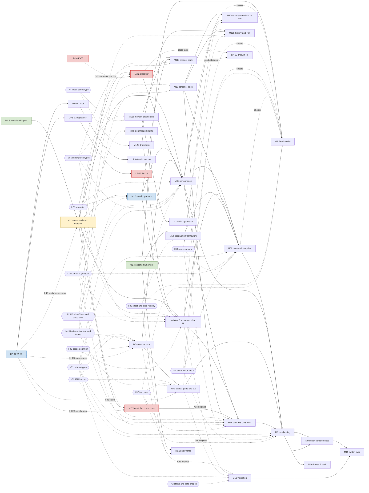

# Module dependency map

DRAFT, 24 Nov 2026, MOD-03 (CHAT-006); revised the same day after an independent review (44 findings, see the end).
Module IDs as in [CODING_MAP.md](CODING_MAP.md). The live page's block-level dependencies stay in
[ARCHITECTURE_AND_DEPENDENCY_MAP.md](../project-control/ARCHITECTURE_AND_DEPENDENCY_MAP.md); this file adds the module
level for parallel work. Labels: [V] verified, [I] inferred, [U] unknown.

## 1. Classes (charter PD-65)

- **A, independent:** needs only code already on main, shares no file with running work. Can start in its own worktree.
- **B, partial:** needs an interface that exists or is about to merge. Starts once that interface is frozen in
  [INTERFACE_CONTRACTS.md](INTERFACE_CONTRACTS.md); codes against the frozen types.
- **C, interdependent:** shares files with other work or needs finished upstream output. Serialised by MOD-03.

**A and B cover engine code only.** Wiring a module's result into the Review (`model/review.ts`, `engine/review.ts`,
`engine/validate/gate.ts`, `ui/store`, `ui/wiring.ts`, `ui/sections/s1-uploads.tsx`) is always C, serialised by MOD-03
through contract I-41 [V: `ReviewRequest` holds only base-file inputs, model/review.ts:84-90; the gate input is fixed
to base issues and totals, gate.ts:10-16].

**Owner gates are separate from the class.** Two overlays apply on top of A/B/C:
- **Phase approval.** The owner has approved only P03-S01 (M1.4) and P03-S02 (M2) [V OWNER_DECISIONS_MOD-03.md:35, :47];
  the rest of Stage 2 "stay[s] to be asked one at a time" [V same file:35]. M3 (P03-S03), M4-M12 (PHASE-04), M13-M16
  (PHASE-05) and PHASE-01/02 sprints are PROPOSED [V tracker:49-53]. Until the owner answers the owner-card question
  "does PD-65 let MOD-03 start roadmap milestones beyond M2 without a per-phase approval?", those modules show
  **needs phase approval** and are not started.
- **Owner-blocked.** A named owner decision (PD-, D-, Q-) is open; see [DEVELOPMENT_BACKLOG.md](DEVELOPMENT_BACKLOG.md) §3.

The roadmap chain (07-implementation-roadmap.md §4: M1.1 -> M1.3 -> M2 -> M3 -> ... -> M15) is a plan order, not a
code dependency [V roadmap §4]. The real dependencies below come from the module scopes and the contract consumer lists [I].

## 2. Class per module

| Module | Class | Gate overlay | Reason |
|---|---|---|---|
| NB-M2.1a S1 | B (coded) | approved (M2) | Gate B GO bound to `aa9c943` [V ARC-02-state.md:187-189]; Gates C, D, OPS-01, then owner demo and "publish" (Gate E) |
| NB-M2.1b S2a | C | owner-blocked | Same files as S1. Correction order (live first under D-028, or new-build first) is an owner question; PD-28 as written covers only C2-C6 [V DECISION_LOG.md:668-680]; PD-36 per alias; S2-Q3. Changes I-28 semantics (scheduled breaking change) |
| NB-M2.2 classifier | B | owner-blocked; starts after S1 merges [V M2-PLAN-v2:183] | Its edge cases are D-7, where the owner supplies the labels [V p02-s04 scope note:58]; KI-051 is a calculation defect, live-first by default [V M2-PLAN-v2:185-189]; new classes widen the closed `ProductClass` union in `model/ids.ts:21` [V], consumed by the S1 matcher (crosswalk.ts:26, 39, 50 [V]). Pure work only in new files |
| NB-M2.2 wiring (incl. liquidity as data) | C | owner-blocked (D-7) | `engine/classify/liquidity.ts` is already wired into `computeReview` [V engine/review.ts:18]; changes C-08 totals and the overview |
| NB-M2.3 S3 | B | approved (M2) | Stacked on S1 (`aa9c943`); shares `tests/helpers/legacy-engine.ts` (S1 creates, S3 extends) [V git diff aa9c943 1e3d7df]. The parsers import only `./cells.ts` and `./mf-monitor.ts` [V]; the monitor parity basis is tied to the `index.html` parser slice (I-43) |
| NB-M3a returns core | B | needs phase approval (P03-S03) | Starts after the I-31, I-32 and I-45 type files merge; the KI-186 acceptance item compares with the live `parseIRR` after TA-03 merges [V roadmap:210], so that part waits on LP-01 |
| NB-M3b performance | B | needs phase approval | Needs the matcher, the monitor parse, the benchmark table, M3a |
| NB-M4a look-through maths | A/B | needs phase approval | Pure maths over refdata; keyed by a stub resolver until I-28 is frozen |
| NB-M4b AMC, scopes, overlap UI | B | needs phase approval | Needs `amcKey` (S1 [V]), M2.3 SOA/bond readers, the scope contract I-45 |
| NB-M5a framework, lint | A/B | needs phase approval | Reuses or extends `exports/pptx/text-lint.ts` (D-029 rule, on main [V]); the RO snapshot-slot part needs I-35 |
| NB-M5b rules, snapshot | C | needs phase approval | Inputs come from M3 and M4 |
| NB-M6 Excel model | B | needs phase approval | M1.4 writer and evaluator exist [V]; grows with every sheet (I-35) |
| NB-M7a reader (`ingest/capital-gains.ts`, blank template) | A | needs phase approval | The roadmap's start-now list names only the "M7 capital-gains reader" [V roadmap:443] |
| NB-M7a engine (`engine/tax/{classify,lots,lot-class,rules,rollup,harvest}`) | B | owner-blocked | Coded on the PD-16 defaults; no merge until PD-16 items 1, 2, 6 and 7 are answered [V DECISION_LOG.md:253, 548-560] and LP-01 has merged, because I-21 is unstable (25 rows on main, 34 on TA-03 [V project-control/INTERFACE_CONTRACTS.md:57]) and D-028 requires shared known answers [V DECISIONS.md:268-272]. Reconciles with IRR-derived gains (AC-18 [V roadmap:268-269, 283-284]), so needs M3a's I-32 |
| NB-M7b cost, IPS, CVS, MFA | C | owner-blocked (transitive) | Needs M3, M4 and M2.1b (risk matcher), so inherits PD-28-type order question, PD-36, S2-Q3; also PD-05, PD-10 |
| NB-M8 | C (types and redemption maths A) | needs phase approval; PD-37 | Needs M3, M5, M7. The roadmap's M8 scope names no M11 input [V roadmap:300-322]; the earlier M11b edge is removed |
| NB-M9a deck frame | B | needs phase approval; Q-07 default to confirm | Needs M1.4 chrome, paginate, manifest [V files on main] and I-35 |
| NB-M9b completeness | C | needs phase approval | Needs every component |
| NB-M10 parser and store | A | needs phase approval | Unzip is decided: vendored JSZip [V roadmap:334; app/vendor/MANIFEST.json:136-140; used on main, postprocess.ts:272, deck.ts:15]. It reaches the store through `ui/wiring.ts`, the only file that imports PptxGenJS [V CLAUDE.md:229; I for the route] |
| NB-M10 identity checks | B | needs phase approval | Needs the crosswalk (I-28) |
| NB-M10u third source in M3b files | B | needs phase approval | Roadmap M10 makes the pack the third source (E-147) and tests it in `portfolio-returns` and `stock-cagr` [V roadmap:349, 359-360]; files are NB-02's, so NB-02 makes the edits after M3b |
| NB-M11a engine core | A | needs phase approval | Classification, fingerprint, idempotency on synthetic files |
| NB-M11b product bank | C | owner-blocked (D-0, D-2, D-8) | Shares M2.3 parsers and the product record with LP-15 |
| NB-M12a drawdown | B | needs phase approval | `ingest/index-series.ts` is in M11's scope [V roadmap:373]; codes against the index-series type I-44 on synthetic series; I-39 not needed |
| NB-M12b history, FoF | B | needs phase approval | Needs the M10 store and the M4 framework; owns `engine/lookthrough/fof.ts` |
| NB-M13 | B (per rule: after its engine) | needs phase approval (PHASE-05) | Changes `ReviewGate`, `gateOf` (model/review.ts:92, gate.ts:68 [V]) and `STATUS`, which every module consumes: freeze I-42 first. The tracker places M13 after PHASE-04 [V tracker:234]; the roadmap says "M13 runs alongside from M5" [V roadmap:457]; running it earlier is a deviation to record as a decision |
| NB-M14 | B | needs phase approval | Needs the refresh-log format (exists [V]) and later the M11 report |
| NB-M15, NB-M16 | C | needs phase approval | Need everything / M8 |
| NB-FU (AC-22, TB-25, docs hygiene) | A | follow-ups of the approved M1.x [I] | CI and docs only; AC-22 outside the refresh merge pause |
| LP-01 TA-03 | C (running) | gates only (PD-64); Gate E PD-01, PD-04, PD-44 | Take-main committed as `d7683a0` (merge of `8cb775e` and `0e483b6`, 24 Nov 23:16) [V git]; Gate A replay next |
| LP-02, LP-04, LP-06, LP-07, LP-11 | C | LP-04 PD-05; LP-07 PD-10; LP-11 PD-63 | Same blocks as LP-01; each after the previous merge |
| LP-03, LP-17, LP-18, LP-23 | C | owner-blocked | `index.html` patches serialise behind LP-01 (CODING_MAP §2 rule). LP-03 owner's ISIN answer; LP-17 PD-36 per alias; LP-18 Q-24; LP-23 owner's yes to the download |
| LP-05, LP-08, LP-09, LP-14 | C | owner-blocked | PD-28 (its own scope, C2-C6) and PD-36; PD-26; PD-31; PD-62 |
| LP-10 TA-26 | B | owner-blocked | PD-55; and OPS-02 registers-4 merged, naming ARC-02 as ARC-01's sole rule-10 successor [V CLAUDE.md:83-84; CHAT_REGISTRY.md:37 still shows ARC-02 QUEUED]. ARC-03 is not the rule-10 Guardian. Guard test on its own new path |
| LP-12 | A | needs phase approval (P02-S01) | Runbook step and reviewed tools |
| LP-13 | C | owner-blocked: PHASE-02 approval, CR, D-2, D-4 [V tracker:181, 252; STAGE2_PLAN_DRAFT:78; scope note:56] | Synthetic fixtures only; no real grid content in the repo until D-2 is answered |
| LP-19 | A | none | Docs and runbook; merges before about 13 Dec |
| LP-20, LP-22 | A (no code) | owner-blocked | Owner material; owner-run Office check |
| LP-15 | C | owner-blocked (D-0, D-2, D-4, D-7, D-8, D-9) | Product record shared with NB-M11b |
| LP-16 | C | owner gate on order | Product-class table shared with NB-M2.2. D-028 default: LP-16 first, M2.2 ports the known answers; new-build first only by a recorded owner exception |
| LP-21 December refresh | C | owner files and "publish" | Touches data blocks; every open branch takes main afterwards |
| OPS-01 | A | partly owner-input (if the GitHub e-mail setting is chosen) | Process |
| OPS-02 registers-4 | C | sanitising step before push | Same record files as LP-01 and NB-M2.1a; merge right after LP-01 |
| OPS-03 | none | owner-blocked | No branch deletion (CLAUDE.md rule 8 [V line 46]); a worktree is removed only on the owner's word after `git branch -r --contains <head>` shows its head on origin [V FILE_OWNERSHIP_AND_CHANGE_CONTROL.md:66-67] |

## 3. Graph

Solid arrows: code dependency. Dotted arrows: contract, shared file or owner decision. Every Consumers entry in
INTERFACE_CONTRACTS §2 is an edge from its contract node.

## 4. What can start now

Only approved M2 sprints, contract types tied to M2, gates-only work (TA-03 under PD-64) and routine operations.
Everything else waits on the owner-card answer on phase approval or on a named owner decision.

| Start now | Class | Owner | First deliverable |
|---|---|---|---|
| LP-01 Gate A, then Gates B-D (gates only, PD-64) | C (running) | EX-02 | from-scratch replay proof of `tools/patches/*` in file-name order on `d7683a0` |
| NB-M2.1a S1 Gates C and D, merge identity, owner demo and "publish" (Gate E), merge | B | NB-02, ARC-02, MOD-03 | Gate C report on `aa9c943` (Gate B GO) |
| NB-M2.3 S3 continues (stacked on S1) | B | NB-02 | PMS, AIF, SOA and analytics readers on synthetic files; upload buttons off |
| M2-tied contract types | A | MOD-03 (independent Gate C) | I-28 "types frozen, semantics versioned" row with S1; I-30 types into `model/vendor.ts` together with C-01; I-41, I-42, I-43 written; I-29 widening proposal (no merge of new classes before D-7) |
| One consolidated owner card | none | MOD-03 | charter format; see DEVELOPMENT_BACKLOG #8 |
| December refresh preparation (LP-19 runbook) | A | MOD-03 until EX-03 opens | runbook update merged before about 13 Dec |
| OPS-01 merge identity | A | MOD-03 (owner only for the account setting) | method restated to D-020 before the next merge |

Not now: every "needs phase approval" item (M3-M16, LP-12, LP-13 and the other PHASE-01/02 sprints), every C item
except LP-01, every owner-blocked item (DEVELOPMENT_BACKLOG §3).
